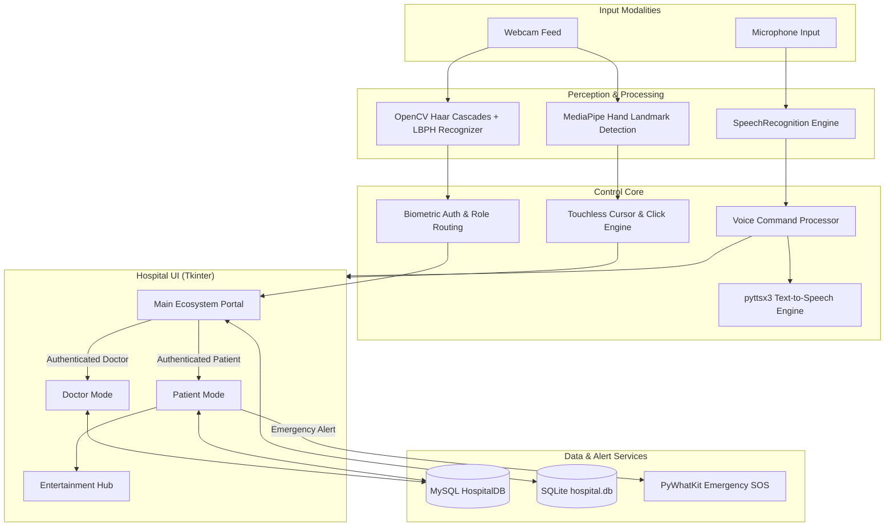

# 🏥 Touchless Ecosystem: AI-Powered Contactless Healthcare System

[](https://python.org)
[](https://opencv.org)
[](https://developers.google.com/mediapipe)
[](https://pypi.org/project/SpeechRecognition/)
[](LICENSE)

An intelligent, zero-touch hospital ecosystem designed for sanitary, contactless interaction in medical environments. Built using **Computer Vision (MediaPipe & OpenCV)**, **Speech Recognition & Text-to-Speech**, and **Biometric Facial Authentication**, this platform enables patients and medical personnel to interact with hospital terminals completely hands-free—reducing nosocomial infection risks while providing intuitive healthcare assistance.

---

## 🌟 Key Features

### 1. 🖐️ Touchless Virtual Mouse (Gesture Control)
- **Real-Time Hand Tracking:** Powered by Google's MediaPipe Hands pipeline.
- **Precision Cursor Motion:** Translates index finger tip coordinates smoothly to desktop screen space using velocity smoothening algorithms.
- **Pinch-to-Click:** Natural pinch gesture (distance between thumb tip and index fingertip < 30px) triggers simulated mouse clicks via `PyAutoGUI`.
- **Zero Physical Touch:** Eliminates cross-contamination on shared hospital screens and kiosks.

### 2. 👤 Biometric Face Authentication
- **Multi-Role Security:** Discrete training pipelines and recognizers for **Doctors** (`trainer_doctor.yml`) and **Patients** (`trainer.yml`).
- **OpenCV LBPH:** Utilizes Local Binary Patterns Histograms (LBPH) face recognizer with Haar Cascade classifiers for rapid, on-device facial authentication.
- **Seamless Login:** Scans and verifies face against database IDs upon launching Doctor or Patient portals without keyboard credentials.

### 3. 🎙️ Hands-Free Voice Assistant & Audio Feedback
- **Voice Navigation:** Command execution via Google Speech Recognition with customizable noise thresholds and phrase limits.
- **Auditory Feedback:** Real-time text-to-speech responses using `pyttsx3`.
- **Live Status Badges:** Visual mic activity status indicators (`🎤 Listening...`, `Processing...`, `Executing...`).

### 4. 🩺 Doctor Management Dashboard
- **Patient Records:** Search and view full patient histories in customizable data grids.
- **Prescription & Diagnosis:** Add diagnostic observations and issue prescriptions directly.
- **Appointment Scheduling:** Schedule and assign follow-up appointments.
- **Medical Report Analytics:** Comprehensive inspection of historical diagnoses, medications, and admission logs.

### 5. 🛌 Patient Comfort & Health Dashboard
- **Personal Health Record:** View assigned doctor, admission status, and expected discharge date.
- **Entertainment Hub:** Voice-driven web browser launching popular streaming platforms (YouTube, Netflix) or custom requested sites.
- **Urgent Emergency SOS:** Instant dispatch of WhatsApp emergency notifications to designated personnel via `pywhatkit`.

### 6. 🗄️ Robust Dual-Database Architecture
- **MySQL Enterprise Backend:** Structured database (`HospitalDB`) managing `Doctors`, `Patients`, `Records`, and `Appointments`.
- **SQLite Local Fallback:** Onboard caching and localized persistence for disconnected environments.

---

## 🏗️ System Architecture



---

## 📂 Project Directory Structure

```plaintext
TouchLessEcosystem/
├── check_V2.py            # Primary application entrypoint (GUI, Gesture Engine, Voice AI)
├── login.py               # Patient face registration and LBPH model trainer
├── login_doctor.py        # Doctor face registration and LBPH model trainer
├── database_setup.sql     # MySQL schema setup and seed data script
├── requirements.txt       # Project dependencies
├── .gitignore             # Git ignore definitions
├── hospital.jpg           # Background visual for main ecosystem window
├── doctor.jpg             # Background visual for doctor dashboard
├── patient.jpg            # Background visual for patient dashboard
├── faces/                 # Captured facial datasets for patients (user_{id}_{count}.jpg)
├── doctor_faces/          # Captured facial datasets for doctors (user_{id}_{count}.jpg)
└── README.md              # Project documentation
```

---

## ⚙️ Prerequisites

1. **Hardware:**
   - Standard HD Webcam (720p or 1080p recommended).
   - Working Microphone.
   - PC running Windows 10/11, Linux, or macOS.

2. **Software:**
   - **Python 3.8 - 3.11** installed.
   - **MySQL Server** (XAMPP, MySQL Workbench, or standalone MySQL service).

---

## 🚀 Getting Started & Installation

### 1. Clone the Repository
```bash
git clone https://github.com/paraspatil31/TouchlessEcosystem-.git
cd TouchlessEcosystem-
```

### 2. Set Up a Virtual Environment (Recommended)
```bash
python -m venv venv
# On Windows:
venv\Scripts\activate
# On Linux / macOS:
source venv/bin/activate
```

### 3. Install Dependencies
```bash
pip install -r requirements.txt
```

> **Note for Windows Users:** If `pyaudio` fails during pip install, install it using pre-compiled wheels:
> ```bash
> pip install pipwin
> pipwin install pyaudio
> ```

---

## 🗄️ Database Setup

1. Start your **MySQL service** (e.g., via MySQL Command Line, MySQL Workbench, or XAMPP).
2. Execute the included SQL setup script:
```bash
mysql -u root -p < database_setup.sql
```
3. Update your database connection settings in `check_V2.py` and `login_doctor.py`:
```python
def connect_database():
    return mysql.connector.connect(
        host="localhost",
        user="root",          # Your MySQL username
        passwd="your_password", # Your MySQL password
        database="HospitalDB"
    )
```
4. Set your emergency alert recipient phone number in `check_V2.py`:
```python
Phone_Number = "+919876543210"  # Target WhatsApp number with country code
```

---

## 📖 How to Run

### Step 1: Register Face Profiles
Capture face images for new patients or doctors (20 frames each):

- **Register Patient Face:**
  In `login.py`, call:
  ```python
  register_face(user_id=1)
  ```
  Run:
  ```bash
  python login.py
  ```

- **Register Doctor Face:**
  In `login_doctor.py`, call:
  ```python
  register_face(user_id=1, is_doctor=True)
  ```
  Run:
  ```bash
  python login_doctor.py
  ```

### Step 2: Train the Face Recognizers
Train the LBPH models on the captured faces:

- **Train Patient Recognizer:**
  ```python
  train_face_recognizer() # Generates trainer.yml
  ```
- **Train Doctor Recognizer:**
  ```python
  train_face_recognizer(is_doctor=True) # Generates trainer_doctor.yml
  ```

### Step 3: Launch the Touchless Ecosystem
Launch the main application interface:
```bash
python check_V2.py
```

---

## 🎮 Interaction & Controls Guide

### 🖐️ Gesture Commands
| Gesture | Action | Description |
| :--- | :--- | :--- |
| **Move Index Finger** | Cursor Movement | Cursor tracks the tip of index finger smoothly across screen. |
| **Pinch (Thumb + Index)** | Left Click | Pinch together (< 30px distance) to execute a mouse click. |
| **Release Pinch** | Release Click | Open fingers back up to resume standard cursor hover. |

### 🗣️ Voice Commands
| Screen / Mode | Voice Command | Executed Action |
| :--- | :--- | :--- |
| **Main Screen** | `"Doctor"` | Launches Doctor Face Authentication |
| **Main Screen** | `"Patient"` | Launches Patient Face Authentication |
| **Doctor Mode** | `"View Records"` | Opens patient records list |
| **Doctor Mode** | `"Prescribe Medicine"` | Opens prescription input dialog |
| **Doctor Mode** | `"Schedule Appointment"` | Opens appointment scheduler |
| **Doctor Mode** | `"Analyze Reports"` | Opens medical report analyzer |
| **Doctor Mode** | `"Urgent Help"` | Dispatches emergency team alert |
| **Patient Mode** | `"Personal Information"` | Displays patient demographics and diagnosis |
| **Patient Mode** | `"Discharge Date"` | Reads and displays expected discharge date |
| **Patient Mode** | `"Entertainment"` | Opens streaming & browser portal |
| **Patient Mode** | `"Urgent Help"` | Sends urgent WhatsApp SOS to hospital nurse/family |
| **Any Mode** | `"Exit"` | Returns to main ecosystem window |

---

## 🛡️ Health & Safety Impact
In clinical spaces, computers, mice, and touchscreens are frequent vectors for infectious pathogens. Touchless Ecosystem addresses this challenge by providing:
- **100% Contactless Input:** No physical peripherals required.
- **Fast Biometric Entry:** Fast patient/staff identification without badges or keypads.
- **Accessibility:** Enables bed-bound or mobility-impaired patients to control entertainment and call emergency assistance independently.

---

## 🤝 Contributing
Contributions, issues, and feature suggestions are welcome!
1. Fork the Project
2. Create your Feature Branch (`git checkout -b feature/NewFeature`)
3. Commit your Changes (`git commit -m 'Add NewFeature'`)
4. Push to the Branch (`git push origin feature/NewFeature`)
5. Open a Pull Request

---

## 📄 License
This project is licensed under the MIT License - see the [LICENSE](LICENSE) file for details.

---

## 👨‍💻 Author
- **Paras Patil** - [GitHub Profile](https://github.com/paraspatil31)
